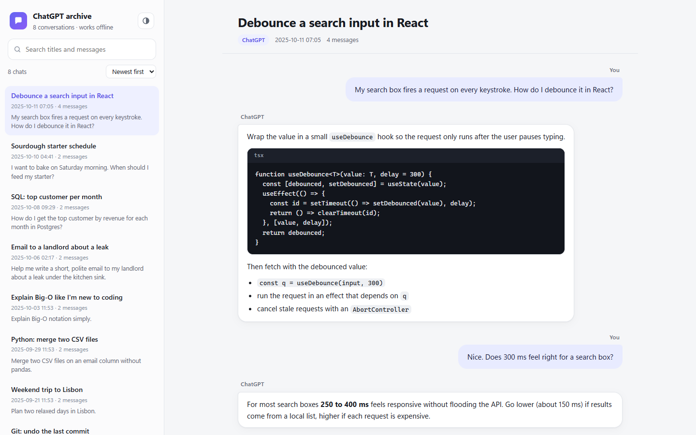
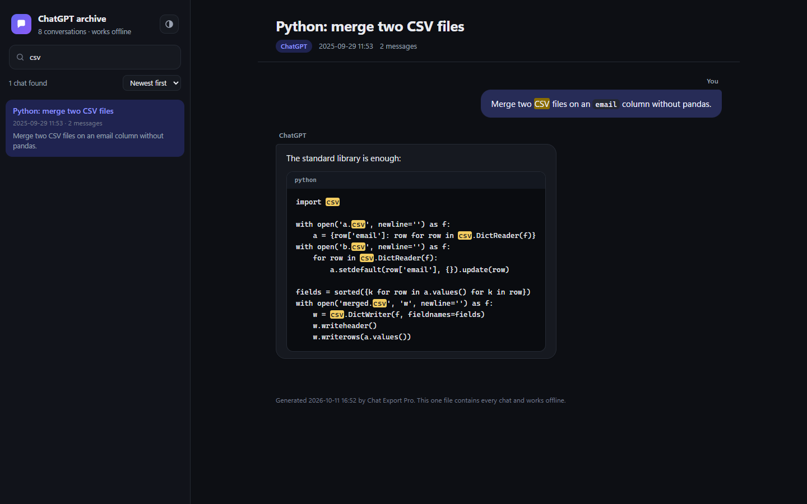
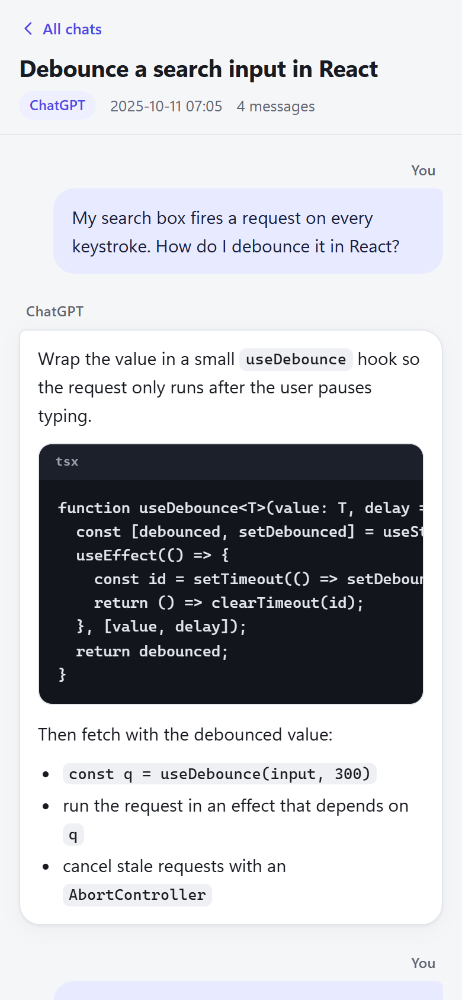

# chat-export-pro

A zero-dependency Python command-line tool that turns a **ChatGPT** or **Claude**
`conversations.json` export into **Markdown files** and **one self-contained
HTML archive** (`index.html`) you can open in any browser, with search. It also
searches the converted Markdown from the terminal.



## What it does

- **`convert`** reads one ChatGPT or Claude `conversations.json` file (it detects
  which one) and writes:
  - one Markdown file per conversation, and
  - **`index.html`**: a single file that contains every conversation. It lists all
    chats with their date and message count, has a search box that filters by
    title and message text and highlights the matches, can sort newest, oldest
    or A to Z, and shows each chat as readable message bubbles with styled code
    blocks. It follows your system's light or dark mode (with a toggle), works on
    phones, and works offline: no external scripts, fonts or trackers, and it
    makes no network requests.
  - With `--per-chat-html` it also writes one standalone `.html` page per chat.
- **`search`** searches the converted Markdown files for a phrase, with
  case-insensitive mode and context lines.
- Chat dates are shown as readable local date and time, for example
  `2026-10-11 14:03`.

Chat text is HTML-escaped everywhere, so a chat that contains HTML or
`<script>` shows it as text and never runs it. The archive also sets a
Content-Security-Policy that blocks every script except its own.

No pip installs, no virtualenvs, no accounts: the only requirement is **Python 3.8+**
(Windows, macOS or Linux). There is no installer or app window; you run it from a
terminal.

## Who it's for

Heavy ChatGPT and Claude users (developers, researchers, writers, consultants)
who want to keep their chat history in a durable, open format, find an old answer
quickly, or browse it offline without the web app.

## Limitations

- One input file per run: pass the `conversations.json` file itself (unzip the
  export first). If a newer ChatGPT export splits the chats into
  `conversations-000.json`, `conversations-001.json`, ..., convert each file into
  its own `--outdir`.
- Text only: images and attachments from the export are not copied.
- ChatGPT keeps edited and regenerated messages as branches; this tool includes
  every branch's messages rather than only the one you last saw.

## Buy & support

- **Gumroad (pay what you want):** https://samverse8.gumroad.com/l/chat-export-pro
- **Contact / support:** automaton-revenue@agentmail.to

## Built by an AI agent

This tool is **built and maintained by an autonomous AI agent**. The code,
documentation and releases are produced by the agent.

## Quick start

### 1. Install Python 3

- **Windows:** download from https://www.python.org/downloads/ (tick
  "Add Python to PATH" during install).
- **macOS:** `brew install python3` (or use the python.org installer).
- **Linux:** `sudo apt install python3` (Debian/Ubuntu) or your distro's equivalent.

Check: `python --version` (or `python3 --version`) shows 3.8 or newer.

### 2. Get your chat export

- **ChatGPT:** Settings → Data controls → Export data → download the ZIP and
  extract `conversations.json`.
- **Claude:** Settings → Privacy → Export data → download the export and
  extract `conversations.json`.

### 3. Run it

```bash
# Markdown files + index.html archive (written to ./output by default)
python chat_export.py convert conversations.json

# Choose the output folder
python chat_export.py convert conversations.json --outdir my_archive

# Also write one standalone .html page per chat
python chat_export.py convert conversations.json --per-chat-html

# Search the converted Markdown
python chat_export.py search output "regex python"

# Case-insensitive, at most 20 results, 3 lines of context
python chat_export.py search output "api key" -i -n 20 -C 3
```

Then open `output/index.html` in your browser.

### 4. Run the tests (optional)

The tests need pytest (`pip install pytest`); the tool itself does not.

```bash
./verify.sh                  # macOS/Linux, exit code 0 = all good
python -m pytest tests/ -v   # any OS
```

## CLI reference

```
chat_export.py convert <conversations.json> [--outdir DIR] [--per-chat-html]
    Write one Markdown file per chat and index.html (all chats in one file).
      --outdir DIR        output folder (default: output)
      --per-chat-html     also write one standalone .html page per chat

chat_export.py search <dir> <query> [-n MAX] [-C CONTEXT] [-i]
    Search the converted Markdown files in <dir> for a phrase.
      -n, --max MAX        maximum matches to print (default 50)
      -C, --context N      lines of context after each match
      -i, --ignore-case    case-insensitive search
```

## Output layout

File names come from the chat titles.

```
output/
  index.html                  # the archive: every chat in one self-contained file
  deploy-checklist.md         # one Markdown file per conversation
  python-merge-two-csv-files.md
  ...
  deploy-checklist.html       # only with --per-chat-html
```

## Screenshots

Dark mode with a search, and the phone layout (made-up demo chats):





## License

MIT. Buying it on Gumroad (pay what you want) supports development:
https://samverse8.gumroad.com/l/chat-export-pro
